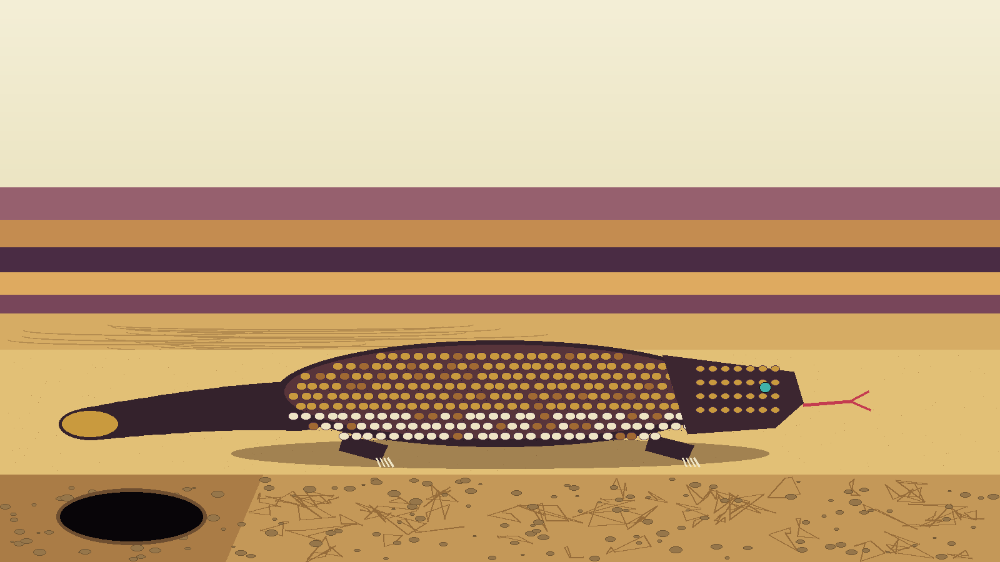
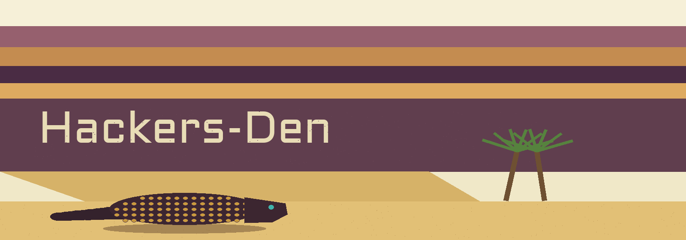
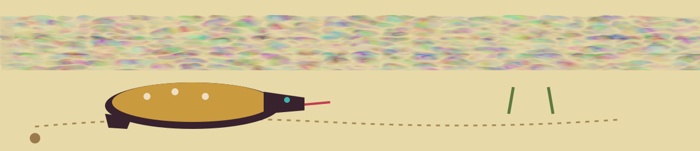

# Hackers-Den

A Matrix-themed cybersecurity RSS newspaper, regenerated daily with GitHub Actions and published with GitHub Pages.





> Burrow note: dist/ is regenerated, do not edit it by hand.

> Burrow note: update_feed.sh also runs the JAR itself as its first step, so running it alone performs the full build.


## About

Hackers-Den is a customized implementation of the RSSpaper project. The RSSpaper JAR reads the feeds listed in `config.yaml` (16 feeds, including Krebs on Security, The Hacker News, Schneier on Security, BleepingComputer, Dark Reading, and the SANS Internet Storm Center podcast) and generates a static newspaper in `dist/`. A post-processing script then applies the Matrix theme on top of the generated site:

- Matrix-inspired green-on-black styling with a "digital rain" background effect
- Terminal-style article headers and staggered article animations
- A service worker and web app manifest, so the generated site can be installed as a PWA and cache its shell assets for offline reading

See `matrix-theme-readme.md` for how the theme layer works.


## How it updates

Two GitHub Actions workflows keep the site current:

1. **Update Hackers Den** (`.github/workflows/update.yml`) runs daily at 03:00 UTC, on pushes to `main`, and on manual dispatch. It runs the RSSpaper JAR with Java 17, refreshes the generated `dist/` output, and commits the result.
2. **Deploy Hackers-Den to GitHub Pages** (`.github/workflows/static.yml`) runs after the update workflow succeeds. It runs `update_feed.sh`, which applies the Matrix theme to the generated site, and deploys `dist/` to GitHub Pages.


## Running it locally

Requirements: Java 17 and `perl` (used by the theme script for two scoped HTML edits), plus network access to fetch the configured feeds.

```bash
java -jar rsspaper-1.2.4-standalone.jar   # generates dist/ from config.yaml
./update_feed.sh                            # applies the Matrix theme to dist/
```

Open `dist/index.html` in a browser to read the result. Note that `update_feed.sh` also runs the JAR itself as its first step, so running it alone performs the full build.


## Repository layout

- `config.yaml` - site title, theme, edition, and the feed list
- `rsspaper-1.2.4-standalone.jar` - the RSSpaper generator (upstream, see Credits)
- `update_feed.sh` - runs the generator, then applies the Matrix theme
- `matrix-theme-backup/` - the canonical copies of the theme CSS and JavaScript that `update_feed.sh` copies into `dist/`
- `themes/` - earlier theme variants kept for reference
- `dist/` - the generated site committed by the update workflow (do not edit by hand; it is regenerated)
- `site_methods.txt` - notes on the newsletters and sources the feed list was built from


## Credits

Based on:

- [RSSPAPER](https://github.com/tanrax/RSSPAPER) - the core RSS feed generator
- [GitHub Pages](https://pages.github.com/) - hosting for the static site


## License

This project is licensed under the terms included in the LICENSE file.


## Author

Created and maintained by CY83R-3X71NC710N
